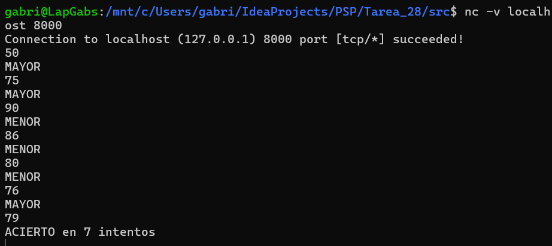

# Juego de adivinar un número mediante TCP

### Gabriela Martínez Menegatty

## 1. Descripción

Esta práctica consiste en desarrollar una aplicación
cliente-servidor utilizando el protocolo TCP.

El servidor genera un número aleatorio entre 1 y 100
y el cliente debe intentar adivinarlo introduciendo
números por teclado.

## 2. Protocolo de comunicación

La comunicación se realiza mediante texto plano.
Cada mensaje se envía en una línea independiente.

El servidor escucha en el puerto `8000`.

| Cliente envía | Servidor responde |
|---|---|
| Número inferior al secreto | MAYOR |
| Número superior al secreto | MENOR |
| Número correcto | ACIERTO en N intentos |
| ADIOS | OK Hasta luego |
| Comando incorrecto | Comando no válido |

## 3. Funcionamiento del servidor

- Genera un número aleatorio entre 1 y 100.
- Espera conexiones mediante `ServerSocket`.
- Recibe los mensajes utilizando `BufferedReader`.
- Compara el número recibido con el número secreto.
- Contabiliza los intentos válidos.
- Envía exactamente una respuesta por cada línea.
- Cierra la conexión cuando recibe `ADIOS`.
- Gestiona las desconexiones inesperadas.
- Permite que se conecten nuevos clientes.

## 4. Funcionamiento del cliente

- Se conecta al servidor mediante `Socket`.
- Solicita números al usuario por teclado.
- Envía los números al servidor.
- Recibe y muestra las respuestas.
- Finaliza cuando el usuario escribe `ADIOS`.

## 5. Gestión de excepciones

Se utiliza `NumberFormatException` para detectar
los comandos que no son números válidos.

También se utiliza `IOException` para gestionar
los errores de comunicación y las desconexiones
inesperadas sin mostrar la traza de la excepción.

## 6. Prueba con Netcat

Para conectarnos al servidor de Windows utilizamos `wsl` 
y ejecutamos los siguientes comandos:

Para iniciar el servidor TCP:

```
javac Servidor_tcp.java
java Servidor_tcp
```

Para conectarnos a Netcat y jugar (en otra terminal wsl):

```
nc -v localhost 8000
```

### Ejemplo de una partida en Netcat



### Ejemplo de una partida

```
50
MAYOR
75
MENOR
65
MAYOR
70
MENOR
68
ACIERTO en 5 intentos
ADIOS
OK Hasta luego
```

## 7. Instrucciones de ejecución

1. Ejecutar la clase `Servidor_tcp.java`.
2. Ejecutar la clase `Cliente_tcp.java`.
3. Introducir números entre 1 y 100.
4. Intentar adivinar el número secreto.
5. Escribir `ADIOS` para finalizar la conexión.

